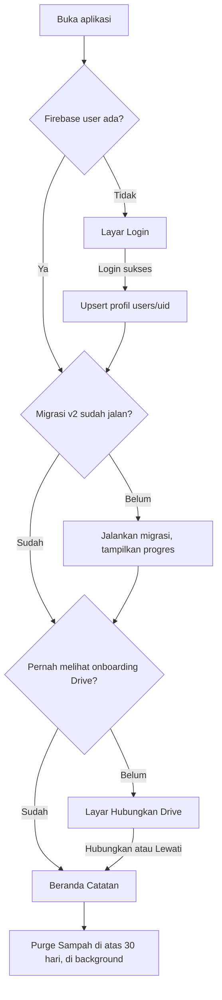
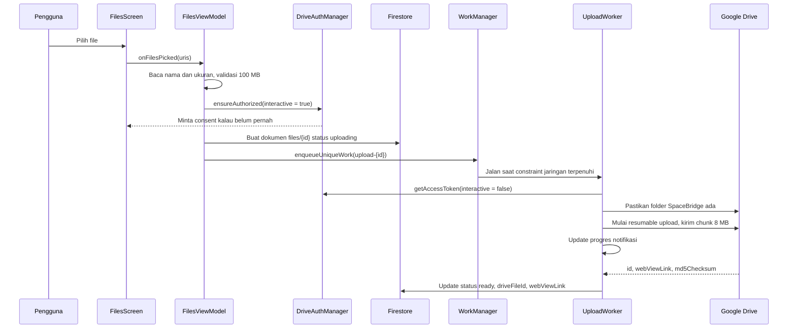
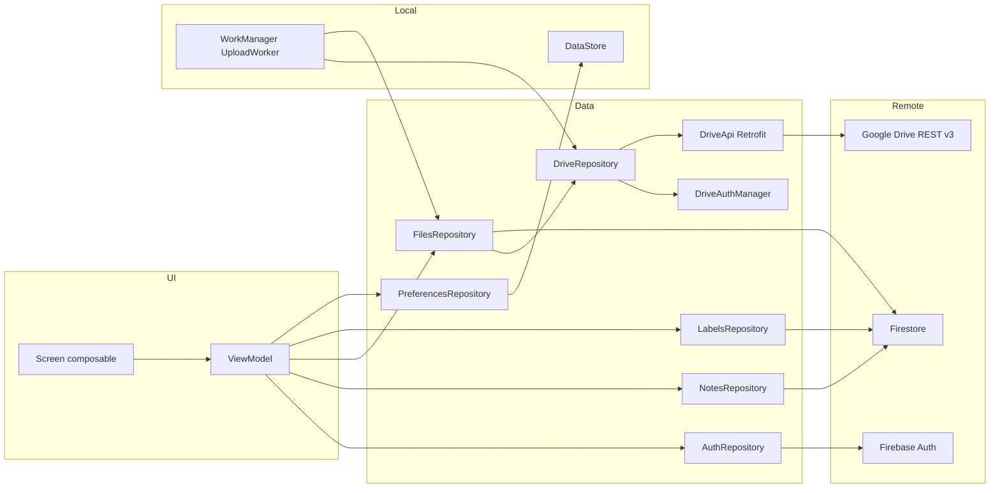

# SpaceBridge v3: product requirements document

| | |
|---|---|
| Versi dokumen | 1.0 |
| Tanggal | 21 Oktober 2026 |
| Platform | Android, Kotlin + Jetpack Compose |
| Status | Siap untuk desain Stitch dan implementasi |
| Dokumen pendamping | [STITCH_SCREENS.md](./STITCH_SCREENS.md) untuk spesifikasi layar, [TASKS.md](./TASKS.md) untuk daftar tugas |
| Menggantikan | `STITCH_IMPLEMENTATION_PLAN.md` di root project |

Cara membaca dokumen ini:

- Desainer atau Stitch cukup membaca bagian 1 sampai 4, lalu `STITCH_SCREENS.md`.
- Implementer membaca semuanya. Bagian 6 sampai 11 adalah kontrak teknis yang tidak boleh diubah tanpa memperbarui dokumen ini.
- Semua nilai visual seperti warna, font, radius, dan spacing diambil dari `docs/DESIGN.md`. PRD ini sengaja tidak menyebut warna.

---

## 1. Ringkasan produk

SpaceBridge adalah aplikasi catatan pribadi untuk Android. Pengguna login dengan akun Google, lalu bisa:

1. Menulis catatan teks biasa.
2. Membuat catatan berupa checklist.
3. Mengunggah file. File fisiknya disimpan di Google Drive milik akun yang sedang login, di folder `SpaceBridge`.

Catatan dan metadata file disimpan di Cloud Firestore di bawah path `users/{uid}`. Security rules memastikan hanya pemilik akun yang bisa membaca dan menulis datanya. Pengguna lain, walaupun login di aplikasi yang sama, tidak bisa melihat apa pun milik orang lain.

Aplikasi dipakai oleh satu keluarga. Setiap anggota punya akun Google sendiri, dan satu HP bisa dipakai bergantian.

### 1.1 Kenapa dirombak

Versi 2 terlihat lengkap, tapi banyak fiturnya hanya tampilan. Daftar lengkapnya ada di [bagian 13](#13-audit-codebase-v2). Yang paling berat:

- Tidak ada upload ke Google Drive sama sekali. Yang tersimpan hanya nama file, link yang diketik manual, dan ukuran palsu.
- Tidak ada fitur Sampah, padahal UI menjanjikannya. Data langsung hilang permanen.
- Tidak ada autosave. Menekan tombol back di editor membuang semua perubahan tanpa peringatan.
- Seluruh logika ada di composable dalam satu file 1.960 baris, dengan data bertipe `Map<String, Any>`.

v3 membangun ulang aplikasi dengan arsitektur berlapis, integrasi Drive sungguhan, dan perilaku offline yang jujur.

---

## 2. Tujuan dan non-tujuan

### 2.1 Tujuan

| ID | Tujuan | Cara mengukur |
|---|---|---|
| G1 | Data setiap pengguna terisolasi | 100% test security rules lulus, termasuk skenario akses lintas uid |
| G2 | Catatan tidak pernah hilang karena lupa simpan | Autosave maksimal 1 detik setelah berhenti mengetik, flush saat keluar layar |
| G3 | File benar-benar tersimpan di Drive pengguna | Setiap file berstatus `ready` punya `driveFileId` yang valid di Drive |
| G4 | Aplikasi tetap bisa dipakai tanpa internet | Buat, ubah, hapus catatan berjalan offline dan tersinkron saat online |
| G5 | Tidak ada tombol yang tidak berfungsi | Setiap kontrol di UI punya aksi nyata atau dihapus |
| G6 | Data pengguna sebelumnya ikut pindah | Migrasi otomatis dari skema v2 tanpa kehilangan catatan |

### 2.2 Non-tujuan untuk v3

- Berbagi atau kolaborasi catatan antar pengguna.
- Pengingat dan notifikasi terjadwal.
- Rich text seperti bold atau italic. Catatan teks tetap plain text.
- Versi web atau iOS.
- Enkripsi end-to-end. Lihat keputusan D1 di [bagian 12](#12-keputusan-terbuka).
- Cloud Functions atau layanan backend sendiri. v3 harus jalan di Firebase paket Spark.

---

## 3. Pengguna dan skenario

### 3.1 Persona

- Pemilik akun. Anggota keluarga dengan akun Google pribadi. Memakai aplikasi untuk daftar belanja, catatan rapat sekolah, dan menyimpan scan dokumen.
- Perangkat bersama. Tablet keluarga tempat beberapa orang login bergantian. Setelah logout, tidak boleh ada sisa data akun sebelumnya di perangkat.

### 3.2 Skenario utama

1. Rina membuka aplikasi pertama kali, login dengan Google, lalu diminta menghubungkan Google Drive. Ia setuju.
2. Rina membuat checklist "Belanja Sabtu" di supermarket tanpa sinyal. Ia mencentang item satu per satu. Saat sinyal kembali, semuanya tersinkron.
3. Rina mengunggah PDF rapor anak 12 MB lewat data seluler. Pengaturan "Unggah hanya via Wi-Fi" aktif, jadi upload menunggu di antrean dan berjalan otomatis saat HP tersambung Wi-Fi.
4. Rina melampirkan PDF itu ke catatan "Rapat wali kelas".
5. Rina tidak sengaja menghapus catatan. Snackbar "Dipindahkan ke Sampah, Urungkan" muncul. Ia menekan Urungkan.
6. Budi, suami Rina, login di tablet yang sama setelah Rina logout. Budi hanya melihat catatannya sendiri, dan cache Rina sudah terhapus dari perangkat.

---

## 4. Ruang lingkup fitur

Prioritas: P0 wajib ada di rilis pertama v3, P1 masuk rilis pertama kalau waktu cukup, P2 setelah rilis.

### 4.1 Autentikasi dan akun

| ID | Fitur | Prioritas |
|---|---|---|
| F-AUTH-1 | Login dengan Google lewat Credential Manager, ditukar ke Firebase Auth | P0 |
| F-AUTH-2 | Sesi tersimpan. Buka ulang aplikasi langsung masuk tanpa login lagi | P0 |
| F-AUTH-3 | Dokumen profil `users/{uid}` dibuat atau diperbarui setiap login | P0 |
| F-AUTH-4 | Logout membersihkan cache Firestore lokal, cache file, antrean upload, dan preferensi akun | P0 |
| F-AUTH-5 | Hapus akun beserta seluruh data, dengan opsi ikut membuang folder SpaceBridge di Drive ke Sampah Drive | P0 |
| F-AUTH-6 | Layar onboarding "Hubungkan Google Drive" setelah login pertama, bisa dilewati | P0 |

Catatan F-AUTH-5: Google Play mewajibkan jalur hapus akun di dalam aplikasi untuk aplikasi yang membuat akun.

### 4.2 Catatan

| ID | Fitur | Prioritas |
|---|---|---|
| F-NOTE-1 | Dua jenis catatan: teks dan checklist | P0 |
| F-NOTE-2 | Daftar catatan aktif, bagian "Disematkan" di atas, sisanya urut `updatedAt` terbaru | P0 |
| F-NOTE-3 | Tampilan grid 2 kolom atau list 1 kolom, pilihan tersimpan | P0 |
| F-NOTE-4 | Pencarian di judul, isi, teks item checklist, dan nama label | P0 |
| F-NOTE-5 | Filter chip: Semua, Teks, Checklist, lalu satu chip per label | P0 untuk tipe, P1 untuk label |
| F-NOTE-6 | Editor dengan autosave, debounce 800 ms, flush saat back atau aplikasi ke background | P0 |
| F-NOTE-7 | Catatan kosong tidak disimpan. Kalau semua field kosong saat keluar, dokumen dihapus | P0 |
| F-NOTE-8 | Sematkan dan lepas sematan | P0 |
| F-NOTE-9 | Pindahkan ke Sampah dengan snackbar Urungkan | P0 |
| F-NOTE-10 | Checklist: Enter membuat item baru di bawahnya, Backspace di item kosong menghapus item dan fokus pindah ke item sebelumnya | P0 |
| F-NOTE-11 | Checklist: item yang dicentang pindah ke bagian "Selesai" yang bisa dilipat | P0 |
| F-NOTE-12 | Checklist: indikator progres "3 dari 7 selesai" | P0 |
| F-NOTE-13 | Ubah jenis catatan teks ke checklist dan sebaliknya | P0 |
| F-NOTE-14 | Indikator status simpan: Menyimpan, Tersimpan, Tersimpan di perangkat | P0 |
| F-NOTE-15 | Arsip catatan | P1 |
| F-NOTE-16 | Label: buat, ubah nama, hapus, pasang ke catatan | P1 |
| F-NOTE-17 | Lampirkan file dari halaman File ke catatan | P1 |
| F-NOTE-18 | Mode pilih banyak dengan tekan lama: sematkan, arsip, hapus, beri label | P1 |
| F-NOTE-19 | Urutkan ulang item checklist dengan drag | P1 |
| F-NOTE-20 | Bagikan isi catatan sebagai teks ke aplikasi lain | P1 |
| F-NOTE-21 | Pilihan urutan: terakhir diubah, terakhir dibuat, judul A-Z | P2 |
| F-NOTE-22 | Centang item checklist langsung dari kartu di beranda | P2 |
| F-NOTE-23 | Duplikat catatan | P2 |

### 4.3 File dan Google Drive

| ID | Fitur | Prioritas |
|---|---|---|
| F-FILE-1 | Otorisasi Drive dengan scope `drive.file` lewat Authorization API | P0 |
| F-FILE-2 | Folder `SpaceBridge` dibuat otomatis di Drive pengguna dan ID-nya disimpan | P0 |
| F-FILE-3 | Pilih satu atau beberapa file, maksimal 10 per sekali pilih, maksimal 100 MB per file | P0 |
| F-FILE-4 | Upload di latar belakang lewat WorkManager, tetap jalan walau aplikasi ditutup | P0 |
| F-FILE-5 | Notifikasi progres upload, tombol batal | P0 |
| F-FILE-6 | Upload yang gagal bisa dicoba ulang. Retry otomatis dengan backoff, maksimal 3 kali | P0 |
| F-FILE-7 | Pengaturan "Unggah hanya via Wi-Fi" benar-benar menjadi constraint WorkManager | P0 |
| F-FILE-8 | Daftar file: ikon tipe, nama, ukuran, tanggal, status | P0 |
| F-FILE-9 | Pencarian nama file dan filter kategori: Semua, Dokumen, Gambar, Spreadsheet, Lainnya | P0 |
| F-FILE-10 | Buka file: unduh ke cache lalu buka dengan aplikasi yang sesuai | P0 |
| F-FILE-11 | Buka di aplikasi atau web Google Drive | P0 |
| F-FILE-12 | Ganti nama, berlaku di Drive dan Firestore | P0 |
| F-FILE-13 | Pindahkan ke Sampah, file di Drive ikut masuk Sampah Drive | P0 |
| F-FILE-14 | Simpan salinan ke folder Download perangkat | P1 |
| F-FILE-15 | Bagikan tautan publik "siapa saja yang punya link bisa melihat", dengan konfirmasi, dan bisa dicabut | P1 |
| F-FILE-16 | Rekonsiliasi dengan Drive: deteksi file yang dihapus atau diganti nama langsung di Drive | P1 |
| F-FILE-17 | Thumbnail untuk gambar | P1 |
| F-FILE-18 | Ringkasan penyimpanan: total ukuran file SpaceBridge, dan kuota Drive akun kalau API mengizinkan | P1 |
| F-FILE-19 | Terima file dari share sheet aplikasi lain, intent `ACTION_SEND` | P2 |

### 4.4 Sampah, pengaturan, dan lainnya

| ID | Fitur | Prioritas |
|---|---|---|
| F-TRASH-1 | Halaman Sampah dengan tab Catatan dan File | P0 |
| F-TRASH-2 | Pulihkan, hapus permanen, kosongkan Sampah | P0 |
| F-TRASH-3 | Item di Sampah lebih dari 30 hari dihapus otomatis saat aplikasi dibuka | P0 |
| F-SET-1 | Halaman Pengaturan layar penuh, menggantikan dialog | P0 |
| F-SET-2 | Tema: Ikuti sistem, Terang, Gelap | P0 |
| F-SET-3 | Status koneksi Drive, tombol hubungkan atau putuskan | P0 |
| F-SET-4 | Ukuran cache lokal dan tombol bersihkan yang benar-benar menghapus cache | P0 |
| F-SET-5 | Versi aplikasi dari `BuildConfig` | P0 |
| F-SET-6 | Tautan kebijakan privasi | P1 |
| F-SYS-1 | Banner offline saat tidak ada jaringan | P0 |
| F-SYS-2 | Penanda per catatan dan per file kalau masih ada perubahan yang belum terkirim ke server | P0 |
| F-SYS-3 | Migrasi data v2 ke skema v3 saat login pertama di v3 | P0 |
| F-SYS-4 | Firebase App Check dengan Play Integrity | P1 |

### 4.5 Yang dihapus dari v2

| Elemen v2 | Alasan |
|---|---|
| Tombol bold, italic, bullet di editor | Tidak pernah berfungsi. Rich text di luar scope |
| Tombol "Sinkronkan Ulang dengan Cloud" | Firestore sudah sinkron realtime. Diganti pull-to-refresh di halaman File untuk rekonsiliasi Drive |
| Input manual "Tautan Drive" saat upload | Diganti upload sungguhan |
| Mode "Hibrida" di editor | Membingungkan karena blok checklist selalu tampil. Diganti dua jenis yang jelas dan bisa dikonversi |
| Badge "Keluarga", "v2.0 Cloud Sync", "Live Sync" statis | Teks dekoratif tanpa arti. Status sinkron diganti indikator yang nyata |
| Dialog Akun terpisah | Digabung ke Pengaturan |
| `LatihanCounter.kt`, `LatihanProfil.kt` | File latihan, tidak dipakai |
| Dependency `firebase-storage` | Tidak dipakai. File disimpan di Drive |

---

## 5. Alur pengguna

### 5.1 Peluncuran aplikasi



### 5.2 Membuat catatan

1. Pengguna menekan FAB tengah di bottom bar. Muncul bottom sheet "Buat baru" dengan tiga pilihan: Catatan, Checklist, Unggah file.
2. Memilih Catatan atau Checklist membuka editor dengan ID dokumen baru yang dibuat di klien. Dokumen belum ditulis ke Firestore.
3. Perubahan pertama yang tidak kosong menulis dokumen dengan `set()`. Perubahan berikutnya memakai `update()` setelah debounce 800 ms.
4. Saat back, perubahan yang tertunda langsung ditulis. Kalau judul, isi, dan item semuanya kosong, dokumen dihapus kalau sudah sempat dibuat.

### 5.3 Upload file



### 5.4 Hapus dan pulihkan

- Hapus catatan: `status = trashed`, `trashedAt = serverTimestamp()`. Snackbar 5 detik dengan aksi Urungkan.
- Hapus file: Drive `PATCH trashed=true`, lalu Firestore `status = trashed`. Kalau sedang offline atau Drive gagal, Firestore tetap diubah dan kolom `pendingDriveOp = "trash"` diisi. Operasi Drive dicoba lagi saat online.
- Hapus permanen catatan: dokumen dihapus, lalu `attachmentIds` di catatan lain yang merujuk ke file tidak tersentuh karena ini catatan.
- Hapus permanen file: Drive `DELETE`, dokumen Firestore dihapus, ID file dicabut dari `attachmentIds` semua catatan.
- Purge otomatis: saat aplikasi dibuka, item `trashed` dengan `trashedAt` lebih lama dari 30 hari dihapus permanen dengan aturan di atas.

---

## 6. Arsitektur aplikasi

### 6.1 Prinsip

- Satu modul `app`, dibagi per paket `core` dan `feature`. Modularisasi Gradle belum perlu untuk ukuran ini.
- MVVM satu arah: Screen membaca `StateFlow<UiState>` dari ViewModel dan mengirim event lewat fungsi. Composable tidak memanggil Firebase atau Drive secara langsung.
- Repository adalah satu-satunya pintu ke Firestore, Drive, dan DataStore.
- Model domain bertipe kuat. Tidak ada `Map<String, Any>` di luar mapper.
- Dependency injection manual lewat `AppContainer`. Hilt tidak dipakai karena project memakai AGP 9 dengan Kotlin bawaan, dan menambah KSP plus Hilt menambah risiko build yang tidak sebanding untuk aplikasi sekecil ini.

### 6.2 Lapisan



### 6.3 Struktur paket

```
com.example.spacebridgeapp
├── SpaceBridgeApplication.kt        App Check, AppContainer, WorkManager config
├── MainActivity.kt                  setContent, edge-to-edge, NavHost
├── di/AppContainer.kt
├── core/
│   ├── model/                       Note, ChecklistItem, DriveFile, Label, AppUser, enum
│   ├── data/
│   │   ├── auth/                    AuthRepository, GoogleSignInHelper
│   │   ├── notes/                   NotesRepository, NoteDto, NoteMapper
│   │   ├── files/                   FilesRepository, FileDto, FileMapper
│   │   ├── labels/                  LabelsRepository
│   │   ├── drive/                   DriveAuthManager, DriveApi, DriveUploader, DriveRepository
│   │   ├── prefs/                   PreferencesRepository
│   │   ├── network/                 ConnectivityObserver
│   │   ├── cache/                   FileCacheManager
│   │   └── migration/               LegacyMigrator
│   ├── work/                        UploadWorker, DriveOpsWorker, WorkerFactory
│   └── util/                        Formatter ukuran dan tanggal, MimeCategory, IdGenerator
├── ui/
│   ├── theme/                       Diturunkan dari docs/DESIGN.md
│   ├── components/                  Komponen bersama
│   └── navigation/                  Routes, SpaceBridgeNavHost, BottomBar
└── feature/
    ├── auth/                        LoginScreen, DriveConnectScreen, ViewModel
    ├── notes/                       NotesScreen, NotesViewModel
    ├── editor/                      EditorScreen, EditorViewModel, ChecklistEditor
    ├── files/                       FilesScreen, FilesViewModel, FileActionsSheet
    ├── trash/                       TrashScreen, TrashViewModel
    ├── archive/                     ArchiveScreen
    ├── labels/                      LabelsScreen, LabelPickerSheet
    └── settings/                    SettingsScreen, DeleteAccountFlow
```

### 6.4 Tech stack

| Kebutuhan | Pilihan | Catatan |
|---|---|---|
| UI | Compose BOM yang sudah ada, Material 3 | Token dari DESIGN.md |
| Navigasi | Navigation Compose 2.9.x, route type-safe dengan `@Serializable` | Butuh plugin `org.jetbrains.kotlin.plugin.serialization` |
| State | `lifecycle-viewmodel-compose`, `collectAsStateWithLifecycle` | |
| Async | Coroutines, Flow, `kotlinx-coroutines-play-services` | |
| Auth | Credential Manager 1.5, `googleid` | Sudah ada |
| Otorisasi Drive | `play-services-auth` terbaru, `Identity.getAuthorizationClient` | Bukan `GoogleSignInClient` yang sudah deprecated |
| Drive API | Retrofit + OkHttp + `kotlinx-serialization` converter, REST v3 | Lebih ringan dari library Java `google-api-services-drive` dan tidak butuh exclude `META-INF` |
| Database | Firebase BOM: `firebase-firestore`, `firebase-auth`, `firebase-appcheck-playintegrity` | Hapus `firebase-storage` |
| Background | WorkManager 2.10.x | |
| Preferensi | DataStore Preferences | Ganti SharedPreferences |
| Gambar | Coil 3 dengan network OkHttp | P1, untuk thumbnail |
| Drag reorder | `sh.calvin.reorderable` | P1 |
| Test | JUnit4, kotlinx-coroutines-test, Turbine, MockK, Firebase Emulator + `@firebase/rules-unit-testing` | |

Versi persis library harus dicek saat implementasi lewat dokumentasi resmi atau Context7. Jangan menebak.

### 6.5 Konvensi state dan event

- Setiap ViewModel mengekspos satu `StateFlow<XxxUiState>` berbentuk `data class` dengan nilai default.
- Event satu kali seperti snackbar dan navigasi dikirim lewat `Channel<XxxEvent>` yang diekspos sebagai `Flow`.
- Error ditampilkan sebagai snackbar dengan pesan bahasa Indonesia dari `strings.xml`. Pesan exception mentah tidak boleh tampil ke pengguna.
- Semua teks UI ada di `res/values/strings.xml`.

### 6.6 Aturan penting Firestore di klien

1. Jangan `await()` hasil `set()`, `update()`, atau `delete()` di alur UI. Saat offline, Task baru selesai setelah server menerima, jadi UI akan menggantung. Panggil tanpa menunggu, dan andalkan cache lokal plus `metadata.hasPendingWrites` untuk status.
2. Pembuatan dokumen memakai `set()` dengan semua field. Perubahan memakai `update()` hanya untuk field yang berubah, ditambah `updatedAt = FieldValue.serverTimestamp()` di setiap update. Security rules mewajibkan ini.
3. Listener memakai `MetadataChanges.INCLUDE` supaya perubahan `hasPendingWrites` ikut terkirim.
4. `serverTimestamp` bernilai null di snapshot lokal sebelum server membalas. Mapper harus memakai `ServerTimestampBehavior.ESTIMATE`.
5. Persistence cache Firestore aktif secara default di Android. Jangan dimatikan.

---

## 7. Model data

### 7.1 Struktur Firestore

```
users/{uid}                          dokumen profil
users/{uid}/notes/{noteId}           catatan
users/{uid}/files/{fileId}           metadata file Drive
users/{uid}/labels/{labelId}         label
users/{uid}/catatan/{id}             LEGACY v2, hanya dibaca untuk migrasi lalu dihapus
```

Koleksi `files` dipakai v2 dan v3. Migrasi menimpa dokumen lama di tempat dengan ID yang sama.

### 7.2 `users/{uid}`

| Field | Tipe | Wajib | Keterangan |
|---|---|---|---|
| `displayName` | string, maks 100 | ya | Dari akun Google |
| `email` | string, maks 200 | ya | |
| `photoUrl` | string atau null | ya | |
| `driveFolderId` | string atau null | ya | ID folder `SpaceBridge` di Drive |
| `migratedV3At` | timestamp atau null | ya | Null berarti migrasi belum jalan |
| `createdAt` | timestamp | ya | Tidak boleh berubah setelah dibuat |
| `lastSeenAt` | timestamp | ya | Diperbarui setiap login |
| `schemaVersion` | int, nilai 1 | ya | |

### 7.3 `users/{uid}/notes/{noteId}`

| Field | Tipe | Wajib | Keterangan |
|---|---|---|---|
| `type` | `"text"` atau `"checklist"` | ya | |
| `title` | string, maks 200 | ya | Boleh kosong |
| `body` | string, maks 20.000 | ya | Selalu `""` untuk checklist |
| `items` | list map, maks 500 | ya | Selalu `[]` untuk teks |
| `items[].id` | string | ya | UUID pendek dari klien, untuk key Compose dan drag |
| `items[].text` | string, maks 1.000 | ya | |
| `items[].checked` | bool | ya | |
| `pinned` | bool | ya | |
| `labelIds` | list string, maks 10 | ya | |
| `attachmentIds` | list string, maks 20 | ya | ID dokumen di `files` |
| `status` | `"active"`, `"archived"`, `"trashed"` | ya | |
| `trashedAt` | timestamp atau null | ya | Diisi saat masuk Sampah |
| `createdAt` | timestamp | ya | |
| `updatedAt` | timestamp | ya | Harus `serverTimestamp()` di setiap tulis |
| `schemaVersion` | int, nilai 1 | ya | |

Urutan item checklist adalah urutan di array. Bagian "Selesai" di UI hanya tampilan, data tetap satu array.

### 7.4 `users/{uid}/files/{fileId}`

| Field | Tipe | Wajib | Keterangan |
|---|---|---|---|
| `name` | string, 1 sampai 255 | ya | Nama tampilan, sama dengan nama di Drive |
| `mimeType` | string, maks 255 | ya | |
| `sizeBytes` | int atau null | ya | Null hanya untuk data legacy |
| `category` | `"document"`, `"image"`, `"spreadsheet"`, `"other"` | ya | Diturunkan dari MIME, lihat 7.6 |
| `source` | `"drive"` atau `"external_link"` | ya | `external_link` hanya untuk data migrasi v2 |
| `driveFileId` | string atau null | ya | Null selama upload |
| `webViewLink` | string atau null | ya | |
| `externalUrl` | string atau null | ya | Hanya untuk `external_link` |
| `md5Checksum` | string atau null | ya | Dari Drive |
| `status` | `"uploading"`, `"ready"`, `"failed"`, `"missing"`, `"trashed"` | ya | |
| `uploadDeviceId` | string atau null | ya | ID instalasi perangkat yang mengunggah |
| `pendingDriveOp` | `"trash"`, `"untrash"`, `"delete"`, `"rename"` atau null | ya | Operasi Drive yang belum berhasil |
| `shared` | bool | ya | Ada permission `anyone` |
| `sharePermissionId` | string atau null | ya | |
| `trashedAt` | timestamp atau null | ya | |
| `createdAt` | timestamp | ya | |
| `updatedAt` | timestamp | ya | `serverTimestamp()` di setiap tulis |
| `schemaVersion` | int, nilai 1 | ya | |

Progres upload dalam persen tidak disimpan di Firestore. Itu hanya ada di WorkManager supaya tidak memboroskan kuota tulis.

### 7.5 `users/{uid}/labels/{labelId}`

| Field | Tipe | Wajib |
|---|---|---|
| `name` | string, 1 sampai 40, unik per pengguna dicek di klien | ya |
| `createdAt` | timestamp | ya |
| `updatedAt` | timestamp | ya |
| `schemaVersion` | int, nilai 1 | ya |

### 7.6 Pemetaan kategori file

| Kategori | MIME |
|---|---|
| `document` | `application/pdf`, `application/msword`, `application/vnd.openxmlformats-officedocument.wordprocessingml.*`, `text/*`, `application/vnd.oasis.opendocument.text`, `application/vnd.ms-powerpoint`, `application/vnd.openxmlformats-officedocument.presentationml.*` |
| `image` | `image/*` |
| `spreadsheet` | `application/vnd.ms-excel`, `application/vnd.openxmlformats-officedocument.spreadsheetml.*`, `text/csv`, `application/vnd.oasis.opendocument.spreadsheet` |
| `other` | Sisanya |

Chip filter di UI: Semua, Dokumen, Gambar, Spreadsheet, Lainnya.

### 7.7 Model domain Kotlin

Kontrak ini mengikat. Nama properti boleh disesuaikan hanya kalau dokumen ini ikut diperbarui.

```kotlin
enum class NoteType { TEXT, CHECKLIST }
enum class NoteStatus { ACTIVE, ARCHIVED, TRASHED }

data class ChecklistItem(val id: String, val text: String, val checked: Boolean)

data class Note(
    val id: String,
    val type: NoteType,
    val title: String,
    val body: String,
    val items: List<ChecklistItem>,
    val pinned: Boolean,
    val labelIds: List<String>,
    val attachmentIds: List<String>,
    val status: NoteStatus,
    val trashedAt: Instant?,
    val createdAt: Instant?,
    val updatedAt: Instant?,
    val hasPendingWrites: Boolean,
)

enum class FileCategory { DOCUMENT, IMAGE, SPREADSHEET, OTHER }
enum class FileSource { DRIVE, EXTERNAL_LINK }
enum class FileStatus { UPLOADING, READY, FAILED, MISSING, TRASHED }

data class DriveFile(
    val id: String,
    val name: String,
    val mimeType: String,
    val sizeBytes: Long?,
    val category: FileCategory,
    val source: FileSource,
    val driveFileId: String?,
    val webViewLink: String?,
    val externalUrl: String?,
    val status: FileStatus,
    val uploadDeviceId: String?,
    val pendingDriveOp: String?,
    val shared: Boolean,
    val trashedAt: Instant?,
    val createdAt: Instant?,
    val updatedAt: Instant?,
    val hasPendingWrites: Boolean,
)

data class Label(val id: String, val name: String)

data class AppUser(val uid: String, val displayName: String, val email: String, val photoUrl: String?)
```

### 7.8 Kontrak repository

```kotlin
interface AuthRepository {
    val currentUser: StateFlow<AppUser?>
    suspend fun signIn(activity: Activity): Result<Unit>
    suspend fun signOut()
    suspend fun deleteAccount(activity: Activity, trashDriveFolder: Boolean): Result<Unit>
}

interface NotesRepository {
    fun observeNotes(status: NoteStatus): Flow<List<Note>>
    fun observeNote(id: String): Flow<Note?>
    fun newId(): String
    fun create(note: Note)
    fun update(id: String, changes: NoteChanges)
    fun setPinned(ids: List<String>, pinned: Boolean)
    fun setStatus(ids: List<String>, status: NoteStatus)
    fun deletePermanently(ids: List<String>)
    fun addLabel(ids: List<String>, labelId: String)
    suspend fun purgeTrashOlderThan(cutoff: Instant)
    suspend fun removeAttachmentEverywhere(fileId: String)
    suspend fun removeLabelEverywhere(labelId: String)
}

interface FilesRepository {
    fun observeFiles(trashed: Boolean): Flow<List<DriveFile>>
    fun observeFile(id: String): Flow<DriveFile?>
    suspend fun enqueueUploads(uris: List<Uri>): UploadEnqueueResult
    fun cancelUpload(id: String)
    fun retryUpload(id: String)
    suspend fun rename(id: String, newName: String): Result<Unit>
    suspend fun moveToTrash(id: String): Result<Unit>
    suspend fun restore(id: String): Result<Unit>
    suspend fun deletePermanently(id: String): Result<Unit>
    suspend fun share(id: String): Result<String>
    suspend fun unshare(id: String): Result<Unit>
    suspend fun openLocalCopy(id: String, onProgress: (Float) -> Unit): Result<Uri>
    suspend fun saveToDownloads(id: String): Result<Unit>
    suspend fun reconcile(force: Boolean = false): Result<ReconcileReport>
    fun observeUploadProgress(): Flow<Map<String, Float>>
    suspend fun storageSummary(): StorageSummary
}
```

`NoteChanges` adalah data class berisi field nullable. Hanya field yang tidak null yang dikirim ke `update()`.

---

## 8. Keamanan

### 8.1 Model ancaman

| Ancaman | Mitigasi |
|---|---|
| Pengguna A membaca data pengguna B | Rules berbasis `request.auth.uid == uid` di semua path |
| Klien modifikasi menulis data sampah atau sangat besar | Validasi tipe, key, dan ukuran di rules |
| Klien palsu memakai project Firebase | App Check dengan Play Integrity, P1 |
| Data akun lama tertinggal di perangkat bersama | Logout menjalankan `terminate()` lalu `clearPersistence()`, menghapus cache file, membatalkan WorkManager, membersihkan DataStore akun |
| Cache ikut ter-backup ke akun Google lain | `data_extraction_rules.xml` dan `backup_rules.xml` mengecualikan database Firestore, cache file, dan DataStore |
| Aplikasi membaca seluruh Drive pengguna | Hanya scope `drive.file`. Aplikasi hanya melihat file yang ia buat sendiri |
| Token bocor ke log | Dilarang log access token, header Authorization, atau isi catatan |

### 8.2 Tentang "hanya pemilik yang bisa melihat"

Rules di bawah menjamin tidak ada pengguna aplikasi yang bisa membaca data pengguna lain. Ada satu batasan yang perlu dipahami: pemilik project Firebase tetap bisa melihat data lewat Firebase Console atau Admin SDK. Kalau pemilik project juga tidak boleh bisa membaca isi catatan, dibutuhkan enkripsi di sisi klien. Ini dicatat sebagai keputusan D1.

### 8.3 Firestore security rules

File: `firestore.rules`. Menggantikan rules v2.

```
rules_version = '2';
service cloud.firestore {
  match /databases/{database}/documents {

    function isOwner(uid) {
      return request.auth != null && request.auth.uid == uid;
    }
    function isStr(v, min, max) {
      return v is string && v.size() >= min && v.size() <= max;
    }
    function isStrOrNull(v, max) {
      return v == null || (v is string && v.size() <= max);
    }
    function isTsOrNull(v) {
      return v == null || v is timestamp;
    }
    function exactKeys(d, keys) {
      return d.keys().hasOnly(keys) && d.keys().hasAll(keys);
    }
    function createdAtOk(d) {
      return d.createdAt is timestamp && d.createdAt <= request.time;
    }
    function createdAtUnchanged(d) {
      return d.createdAt == resource.data.createdAt;
    }

    match /users/{uid} {
      function validProfile(d) {
        return exactKeys(d, ['displayName','email','photoUrl','driveFolderId',
                             'migratedV3At','createdAt','lastSeenAt','schemaVersion'])
          && isStr(d.displayName, 0, 100)
          && isStr(d.email, 0, 200)
          && isStrOrNull(d.photoUrl, 2000)
          && isStrOrNull(d.driveFolderId, 200)
          && isTsOrNull(d.migratedV3At)
          && d.lastSeenAt is timestamp
          && d.schemaVersion == 1;
      }

      allow get, delete: if isOwner(uid);
      allow list: if false;
      allow create: if isOwner(uid) && validProfile(request.resource.data)
                    && createdAtOk(request.resource.data);
      allow update: if isOwner(uid) && validProfile(request.resource.data)
                    && createdAtUnchanged(request.resource.data);

      match /notes/{noteId} {
        function validNote(d) {
          return exactKeys(d, ['type','title','body','items','pinned','labelIds',
                               'attachmentIds','status','trashedAt','createdAt',
                               'updatedAt','schemaVersion'])
            && d.type in ['text','checklist']
            && isStr(d.title, 0, 200)
            && isStr(d.body, 0, 20000)
            && d.items is list && d.items.size() <= 500
            && d.pinned is bool
            && d.labelIds is list && d.labelIds.size() <= 10
            && d.attachmentIds is list && d.attachmentIds.size() <= 20
            && d.status in ['active','archived','trashed']
            && isTsOrNull(d.trashedAt)
            && d.updatedAt == request.time
            && d.schemaVersion == 1;
        }
        allow read, delete: if isOwner(uid);
        allow create: if isOwner(uid) && validNote(request.resource.data)
                      && createdAtOk(request.resource.data);
        allow update: if isOwner(uid) && validNote(request.resource.data)
                      && createdAtUnchanged(request.resource.data);
      }

      match /files/{fileId} {
        function validFile(d) {
          return exactKeys(d, ['name','mimeType','sizeBytes','category','source',
                               'driveFileId','webViewLink','externalUrl','md5Checksum',
                               'status','uploadDeviceId','pendingDriveOp','shared',
                               'sharePermissionId','trashedAt','createdAt','updatedAt',
                               'schemaVersion'])
            && isStr(d.name, 1, 255)
            && isStr(d.mimeType, 0, 255)
            && (d.sizeBytes == null || (d.sizeBytes is int && d.sizeBytes >= 0
                                        && d.sizeBytes <= 104857600))
            && d.category in ['document','image','spreadsheet','other']
            && d.source in ['drive','external_link']
            && isStrOrNull(d.driveFileId, 200)
            && isStrOrNull(d.webViewLink, 2000)
            && isStrOrNull(d.externalUrl, 2000)
            && isStrOrNull(d.md5Checksum, 64)
            && d.status in ['uploading','ready','failed','missing','trashed']
            && isStrOrNull(d.uploadDeviceId, 100)
            && (d.pendingDriveOp == null
                || d.pendingDriveOp in ['trash','untrash','delete','rename'])
            && d.shared is bool
            && isStrOrNull(d.sharePermissionId, 200)
            && isTsOrNull(d.trashedAt)
            && d.updatedAt == request.time
            && d.schemaVersion == 1;
        }
        allow read, delete: if isOwner(uid);
        allow create: if isOwner(uid) && validFile(request.resource.data)
                      && createdAtOk(request.resource.data);
        allow update: if isOwner(uid) && validFile(request.resource.data)
                      && (createdAtUnchanged(request.resource.data)
                          || !('schemaVersion' in resource.data));
      }

      match /labels/{labelId} {
        allow read, delete: if isOwner(uid);
        allow create, update: if isOwner(uid)
          && exactKeys(request.resource.data, ['name','createdAt','updatedAt','schemaVersion'])
          && isStr(request.resource.data.name, 1, 40)
          && request.resource.data.createdAt is timestamp
          && request.resource.data.updatedAt == request.time
          && request.resource.data.schemaVersion == 1;
      }

      match /catatan/{legacyId} {
        allow read, delete: if isOwner(uid);
      }
    }
  }
}
```

Catatan rules:

- Rules tidak bisa memvalidasi isi setiap elemen list. Isi `items`, `labelIds`, dan `attachmentIds` divalidasi di klien. Batas ukuran dokumen 1 MiB tetap berlaku.
- Kondisi `!('schemaVersion' in resource.data)` di update `files` mengizinkan migrasi menimpa dokumen v2 yang belum punya `createdAt`.
- `allow list: if false` di `users` mencegah siapa pun mengambil daftar semua pengguna.

### 8.4 Index Firestore

File: `firestore.indexes.json`.

| Koleksi | Field | Dipakai untuk |
|---|---|---|
| `notes` | `status` ASC, `updatedAt` DESC | Beranda dan Arsip |
| `notes` | `status` ASC, `trashedAt` DESC | Sampah dan purge |
| `files` | `status` ASC, `createdAt` DESC | Daftar file dengan `whereIn status` |
| `files` | `status` ASC, `trashedAt` DESC | Sampah file dan purge |

Query `attachmentIds array-contains` dan `labelIds array-contains` memakai index otomatis single-field.

---

## 9. Integrasi Google Drive

### 9.1 Persiapan di Google Cloud Console

1. Aktifkan Google Drive API di project Google Cloud yang sama dengan Firebase.
2. OAuth consent screen: user type External, isi nama aplikasi dan email dukungan, tambahkan scope `https://www.googleapis.com/auth/drive.file`.
3. Ubah status publikasi ke In production. Scope `drive.file` termasuk non-sensitive sehingga tidak perlu verifikasi penuh. Kalau dibiarkan di status Testing, hanya akun yang terdaftar sebagai test user yang bisa memberi izin.
4. Pastikan OAuth client Android untuk package `com.example.spacebridgeapp` dengan SHA-1 debug dan release sudah terdaftar. Client ini juga dipakai Firebase Auth.

### 9.2 Otorisasi

Login dan otorisasi Drive dipisah. Login memakai Credential Manager seperti v2. Akses Drive diminta terpisah lewat `AuthorizationClient`, saat onboarding atau saat pertama kali pengguna mengunggah.

```kotlin
sealed interface DriveAuthResult {
    data class Granted(val accessToken: String) : DriveAuthResult
    data class NeedsConsent(val pendingIntent: PendingIntent) : DriveAuthResult
    data class Failed(val reason: String) : DriveAuthResult
}

interface DriveAuthManager {
    val isAuthorized: StateFlow<Boolean>
    suspend fun authorize(): DriveAuthResult
    suspend fun handleConsentResult(data: Intent?): DriveAuthResult
    suspend fun getTokenSilently(): String?
    suspend fun invalidateToken(token: String)
    suspend fun revoke()
}
```

Aturan:

- `AuthorizationRequest` memakai `setRequestedScopes(listOf(Scope(DRIVE_FILE)))` dan `setAccount(Account(email, "com.google"))` dengan email pengguna Firebase. Tanpa `setAccount`, pengguna bisa memberi izin Drive dari akun yang berbeda dengan akun login.
- UI meluncurkan `NeedsConsent.pendingIntent` lewat `ActivityResultContracts.StartIntentSenderForResult`.
- Worker hanya boleh memanggil `getTokenSilently()`. Kalau hasilnya null, worker gagal dengan kode `NEEDS_CONSENT`. Dokumen file diberi status `failed`, dan notifikasi "Izin Google Drive dibutuhkan" yang membuka aplikasi ditampilkan.
- Respons HTTP 401 memicu `invalidateToken()` lalu `getTokenSilently()` sekali lagi. Kalau masih 401, perlakukan sebagai `NEEDS_CONSENT`.
- `isAuthorized` disimpan di DataStore akun dan diperbarui setiap kali `authorize()` berhasil atau gagal.

### 9.3 Endpoint REST v3

Base URL `https://www.googleapis.com`. Semua request memakai header `Authorization: Bearer <token>`. Selalu kirim parameter `fields` supaya respons ringkas.

| Operasi | Method dan path | Body atau parameter penting |
|---|---|---|
| Cari folder root | `GET /drive/v3/files` | `q=appProperties has { key='spacebridge' and value='root' } and trashed=false`, `fields=files(id)` |
| Buat folder root | `POST /drive/v3/files` | `{"name":"SpaceBridge","mimeType":"application/vnd.google-apps.folder","appProperties":{"spacebridge":"root"}}` |
| Cek file atau folder | `GET /drive/v3/files/{id}` | `fields=id,name,mimeType,size,md5Checksum,webViewLink,trashed` |
| Daftar isi folder | `GET /drive/v3/files` | `q='{folderId}' in parents`, `pageSize=200`, `fields=nextPageToken,files(id,name,mimeType,size,md5Checksum,webViewLink,trashed,appProperties)` |
| Mulai resumable upload | `POST /upload/drive/v3/files?uploadType=resumable` | Header `X-Upload-Content-Type`, `X-Upload-Content-Length`. Body `{"name", "parents":[folderId], "appProperties":{"spacebridgeFileId": fileId}}`. URL sesi ada di header `Location` |
| Kirim chunk | `PUT {sessionUrl}` | `Content-Range: bytes {start}-{end}/{total}`. Respons 308 berarti lanjut, header `Range` menunjukkan byte terakhir yang diterima. 200 atau 201 berarti selesai |
| Cek posisi sesi | `PUT {sessionUrl}` | `Content-Range: bytes */{total}`, body kosong |
| Unduh isi | `GET /drive/v3/files/{id}?alt=media` | Stream ke file |
| Ganti nama | `PATCH /drive/v3/files/{id}` | `{"name": "..."}` |
| Ke Sampah atau pulihkan | `PATCH /drive/v3/files/{id}` | `{"trashed": true}` atau `false` |
| Hapus permanen | `DELETE /drive/v3/files/{id}` | |
| Buat tautan publik | `POST /drive/v3/files/{id}/permissions` | `{"type":"anyone","role":"reader"}`, `fields=id` |
| Cabut tautan | `DELETE /drive/v3/files/{id}/permissions/{permissionId}` | |
| Kuota akun | `GET /drive/v3/about?fields=storageQuota` | Belum pasti diizinkan dengan `drive.file`. Lihat task SPIKE-1 |

`appProperties.spacebridgeFileId` menghubungkan file Drive ke dokumen Firestore. Rekonsiliasi memakai field ini.

### 9.4 Upload

- File dipilih dengan `ActivityResultContracts.OpenMultipleDocuments`, lalu `takePersistableUriPermission` dipanggil untuk setiap URI. Tanpa ini, worker bisa kehilangan akses ke file setelah aplikasi ditutup. Jangan pakai `GetContent` seperti v2.
- Nama dan ukuran dibaca dari `OpenableColumns.DISPLAY_NAME` dan `OpenableColumns.SIZE`. v2 memakai `uri.path` yang menghasilkan nama seperti `document:1234`.
- File di atas 100 MB ditolak sebelum masuk antrean, dengan pesan yang menyebut nama file.
- Chunk 8 MB. Ukuran harus kelipatan 256 KB sesuai aturan Drive.
- URL sesi disimpan per `fileId` di DataStore khusus upload. Kalau worker dimulai ulang, ia menanyakan posisi sesi dan melanjutkan dari sana. Sesi resumable Drive berlaku sekitar satu minggu.
- Worker berjalan sebagai foreground work dengan tipe `dataSync` dan menampilkan notifikasi progres. Manifest perlu izin `FOREGROUND_SERVICE`, `FOREGROUND_SERVICE_DATA_SYNC`, `POST_NOTIFICATIONS`, dan deklarasi `SystemForegroundService` dengan `foregroundServiceType="dataSync"`.
- Izin `POST_NOTIFICATIONS` diminta sebelum upload pertama. Kalau ditolak, upload tetap jalan.
- Constraint: `NetworkType.CONNECTED`, atau `NetworkType.UNMETERED` kalau "Unggah hanya via Wi-Fi" aktif. Mengubah pengaturan ini juga memperbarui constraint pekerjaan yang masih antre.
- Nama unique work: `upload-{fileId}`, dengan `ExistingWorkPolicy.KEEP`.

### 9.5 Pemetaan error Drive

| Kondisi | Tindakan worker | Pesan untuk pengguna |
|---|---|---|
| Tidak ada jaringan, timeout | `Result.retry()` | Tidak ada, status tetap Mengunggah |
| 401 | Invalidate token, coba sekali, lalu `NEEDS_CONSENT` | Izin Google Drive dibutuhkan |
| 403 `storageQuotaExceeded` | `failure`, status `failed` | Penyimpanan Google Drive penuh |
| 403 `rateLimitExceeded` atau `userRateLimitExceeded`, 429 | `retry` dengan backoff eksponensial | Tidak ada |
| 404 pada sesi upload | Mulai sesi baru dari byte 0 | Tidak ada |
| 404 pada file saat operasi lain | Set status `missing` | File tidak ditemukan di Google Drive |
| 5xx | `retry`, maksimal 3 percobaan | Setelah habis: Unggahan gagal, coba lagi |
| URI tidak bisa dibaca | `failure` | File asli tidak bisa diakses lagi |

### 9.6 Rekonsiliasi, P1

Dijalankan saat halaman File dibuka, maksimal sekali per 10 menit, atau lewat pull-to-refresh.

1. Ambil seluruh isi folder `SpaceBridge`, termasuk yang `trashed`, dengan paging.
2. Untuk setiap dokumen Firestore `ready` yang `driveFileId`-nya tidak ada di Drive: set `missing`.
3. Dokumen `ready` yang file Drive-nya `trashed=true`: set `trashed` dengan `trashedAt` sekarang.
4. Nama di Drive berbeda dengan Firestore: Firestore mengikuti Drive.
5. File Drive dengan `appProperties.spacebridgeFileId` yang dokumennya tidak ada di Firestore: buat dokumen baru dengan ID itu dan status `ready`.
6. Dokumen `uploading` milik perangkat lain yang `updatedAt`-nya lebih dari 24 jam: set `failed`.
7. Dokumen yang punya `pendingDriveOp`: jalankan ulang operasinya, lalu kosongkan field tersebut.

### 9.7 Membuka dan mengunduh

- Buka file: unduh ke `cacheDir/drive/{fileId}/{name}` kalau belum ada atau `md5Checksum` berbeda, lalu `ACTION_VIEW` lewat `FileProvider` dengan `FLAG_GRANT_READ_URI_PERMISSION`. Tampilkan dialog progres yang bisa dibatalkan.
- Batas cache 300 MB. Saat lewat batas, hapus file dengan akses terlama.
- Kalau tidak ada aplikasi yang bisa membuka MIME tersebut, tawarkan "Buka di Google Drive".
- Simpan salinan: tulis ke `MediaStore.Downloads` dengan subfolder `SpaceBridge`. Tidak butuh izin storage di API 29 ke atas.
- Buka di Drive: `ACTION_VIEW` ke `webViewLink`.

---

## 10. Offline dan sinkronisasi

| Aksi | Offline | Catatan |
|---|---|---|
| Lihat catatan dan file | Ya | Dari cache Firestore |
| Buat, ubah, sematkan, hapus catatan | Ya | Ditandai "Tersimpan di perangkat" sampai server menerima |
| Kelola label | Ya | |
| Pilih file untuk diunggah | Ya | Masuk antrean, jalan saat online |
| Buka file | Hanya kalau sudah ada di cache | Kalau belum: "Butuh koneksi untuk membuka file ini" |
| Ganti nama, hapus, pulihkan file | Ya untuk Firestore | Operasi Drive disimpan di `pendingDriveOp` dan dikerjakan `DriveOpsWorker` saat online |
| Bagikan tautan | Tidak | Tombol nonaktif dengan keterangan |
| Login, hapus akun | Tidak | |

Konflik: last write wins per field, sesuai perilaku Firestore. Editor mendengarkan dokumen yang sedang dibuka. Kalau ada perubahan dari perangkat lain dan editor tidak sedang punya perubahan lokal yang belum ditulis, isi editor diperbarui. Kalau editor sedang punya perubahan lokal, perubahan lokal yang menang. Satu pengguna jarang mengedit catatan yang sama di dua HP pada detik yang sama, jadi pendekatan ini cukup.

Banner offline muncul dari `ConnectivityObserver` yang memakai `ConnectivityManager.registerDefaultNetworkCallback`.

---

## 11. Kebutuhan non-fungsional

| Area | Kebutuhan |
|---|---|
| Performa | Cold start sampai daftar catatan tampil dari cache di bawah 1,5 detik di HP kelas menengah. Scroll 1.000 catatan tanpa jank, semua lazy list memakai `key` |
| Ukuran | Release build dengan R8 aktif. Keep rules untuk kelas `@Serializable` |
| SDK | minSdk 30, targetSdk 36, edge-to-edge, predictive back |
| Aksesibilitas | Semua ikon interaktif punya `contentDescription`. Target sentuh minimal 48 dp. Layout tetap terbaca di font scale 200%. Kontras mengikuti DESIGN.md |
| Bahasa | Bahasa Indonesia. Semua string di `strings.xml`. Format tanggal dan angka memakai locale `id-ID` |
| Privasi | Tidak ada analytics pihak ketiga. Crashlytics opsional, tanpa isi catatan di log |
| Kualitas | Ktlint lulus. Unit test untuk semua ViewModel dan mapper. Test rules di emulator lulus |
| Biaya | Berjalan di Firebase paket Spark tanpa Cloud Functions |

---

## 12. Keputusan terbuka

Nilai default dipakai kalau tidak ada keputusan lain sebelum implementasi.

| ID | Pertanyaan | Default | Dampak kalau diubah |
|---|---|---|---|
| D1 | Apakah pemilik project Firebase juga tidak boleh bisa membaca isi catatan? | Tidak. Isolasi cukup antar pengguna aplikasi | Kalau ya: enkripsi klien dengan kunci di Android Keystore. Pencarian jadi lokal saja dan ganti HP butuh mekanisme pemulihan kunci. Tambahan sekitar 2 sampai 3 minggu |
| D2 | Pindah ke paket Blaze? | Tidak | Kalau ya: purge Sampah bisa pakai TTL Firestore, dan hapus akun bisa lewat Cloud Function yang lebih andal |
| D3 | Data file v2 yang hanya berisi link manual | Dimigrasi sebagai `external_link`. Bisa dibuka dan dihapus, tidak bisa dibagikan atau diganti nama di Drive | Bisa juga dibuang, tapi itu menghapus data pengguna tanpa izin |
| D4 | Batas ukuran per file | 100 MB | Lebih besar butuh foreground work lebih lama dan nilai baru di rules |
| D5 | Kartu kuota Drive akun | Tampil hanya kalau SPIKE-1 membuktikan `about.get` jalan dengan `drive.file`. Kalau tidak, tampilkan total ukuran file SpaceBridge saja | Meminta scope lebih luas seperti `drive.metadata.readonly` membuat aplikasi wajib verifikasi Google |
| D6 | Nama package `com.example.spacebridgeapp` | Tetap | Google Play menolak package `com.example`. Kalau mau rilis di Play Store, ganti sebelum rilis karena SHA-1 dan OAuth client ikut berubah |

---

## 13. Audit codebase v2

Temuan dari kode saat ini. Semuanya ditangani di v3.

| # | Temuan | Lokasi | Penanganan di v3 |
|---|---|---|---|
| 1 | Tidak ada upload ke Drive. Hanya metadata dengan ukuran tertulis mati `"2.4 MB"` dan link manual | `MainActivity.kt` baris 1417 sampai 1458 | Bagian 9 |
| 2 | Nama file diambil dari `uri.path`, hasilnya bukan nama asli | `MainActivity.kt` baris 1118 | `OpenableColumns` |
| 3 | `launcherFilePicker.launch` dipanggil langsung di composition, bisa terpanggil berulang | `MainActivity.kt` baris 1124 sampai 1127 | Event dari ViewModel |
| 4 | Hapus catatan dan file adalah hard delete, padahal toast bilang "dipindahkan ke Sampah". File di Drive tidak ikut terhapus | `MainActivity.kt` baris 451, 1355 | Fitur Sampah |
| 5 | Ganti nama file hanya mengubah Firestore | `MainActivity.kt` baris 1373 | Drive dan Firestore |
| 6 | Label "Tersimpan otomatis" tanpa autosave. Back membuang perubahan. Tombol back sistem di editor menutup aplikasi karena tidak ada `BackHandler` dan navigasi memakai boolean | `MainActivity.kt` baris 195, 589, 1004 | Autosave dan Navigation Compose |
| 7 | Field `waktu` ditimpa setiap simpan, tidak ada tanggal dibuat | `MainActivity.kt` baris 1014 | `createdAt` dan `updatedAt` |
| 8 | Daftar hasil filter memakai `remember(daftarCatatan, ...)` dengan instance list yang sama, jadi tidak dihitung ulang saat snapshot berubah | `MainActivity.kt` baris 381, 1236 | State dari ViewModel |
| 9 | Mode Hibrida selalu menampilkan blok checklist, jenis catatan ditentukan diam-diam saat simpan | `MainActivity.kt` baris 760, 1007 | Dua jenis yang jelas |
| 10 | Tombol mati: format teks, tombol Tune, sakelar Wi-Fi yang tidak tersimpan, bersihkan cache palsu, sinkron ulang palsu, tombol sync di kartu Drive | `MainActivity.kt` baris 338, 992, 1147, 1485, 1716, 1941 | Dihapus atau diberi fungsi nyata |
| 11 | Status "Terhubung ke Cloud" dan "Google Drive: Terhubung" ditulis mati | `MainActivity.kt` baris 324, `Auth.kt` baris 441 | Status dari `ConnectivityObserver` dan `DriveAuthManager` |
| 12 | Logout tidak membersihkan cache Firestore di perangkat | `Auth.kt` baris 116 | Bagian 8.1 |
| 13 | Rules hanya cek kepemilikan, tanpa validasi skema | `firestore.rules` | Bagian 8.3 |
| 14 | Semua logika di composable, data `Map<String, Any>`, satu file 1.960 baris | `MainActivity.kt` | Arsitektur bagian 6 |
| 15 | R8 nonaktif di release | `app/build.gradle.kts` baris 33 | Diaktifkan |
| 16 | `allowBackup` aktif tanpa mengecualikan cache | `AndroidManifest.xml` | Aturan backup baru |
| 17 | Preferensi tema di SharedPreferences, tanpa opsi ikut sistem | `MainActivity.kt` baris 149 | DataStore, tiga opsi |
| 18 | Error ditampilkan lewat Toast dengan pesan exception mentah | Banyak tempat | Snackbar dengan pesan dari `strings.xml` |
| 19 | `firebase-storage` dan file `Latihan*.kt` tidak dipakai | | Dihapus |

---

## 14. Rencana rilis

| Milestone | Isi | Kriteria selesai |
|---|---|---|
| M0 Fondasi | Setup dependency, arsitektur, tema dari DESIGN.md, navigasi, komponen dasar | Aplikasi kosong jalan dengan navigasi dan tema terang dan gelap |
| M1 Akun | Login, profil, logout bersih, onboarding Drive | Login dan logout di dua akun bergantian tanpa sisa data |
| M2 Catatan | Beranda, editor teks dan checklist, autosave, sematkan, Sampah catatan, migrasi v2 | Semua F-NOTE P0 dan F-SYS-3 lulus |
| M3 File | Otorisasi Drive, upload worker, daftar, buka, ganti nama, Sampah file | Semua F-FILE P0 lulus di HP fisik |
| M4 Organisasi | Label, arsip, lampiran, pilih banyak, bagikan, rekonsiliasi, thumbnail | Fitur P1 yang dipilih lulus |
| M5 Rilis | Pengaturan lengkap, hapus akun, App Check, R8, aturan backup, test, deploy rules | Checklist rilis di TASKS.md terpenuhi |
